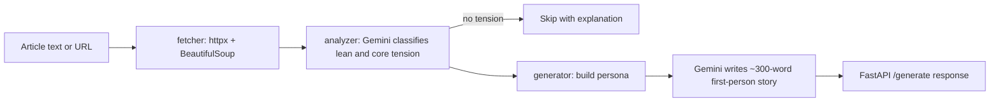

# Firsthand

**Read a news article, then hear from the person on the other side of it.**

Firsthand takes an article (pasted or by URL) and uses Gemini to write a short, first-person story from a fictional but realistic American whose life put them on the opposite side of the issue. It does not argue. It tries to make the other perspective feel like a person you just met.

## Why I built it

Most "other side" content is a counter-argument, and counter-arguments rarely change how anyone feels. I wanted to see whether lived experience, told plainly and without a moral, could do what a rebuttal can't. It is also a compact exercise in prompt design: getting an LLM to produce consistent, structured output at one step and controlled, human-sounding prose at the next.

## Features

- Accepts pasted article text or a URL, with scraping and clear error messages for paywalls, blocked sites and JavaScript-only pages
- Two-step LLM pipeline: classify the article, then generate the story
- Persona builder that picks a name, age and location from region and life-stage banks, and avoids repeating recent regions and names
- Skips articles with no real values-based tension (sports, entertainment, pure science) instead of forcing a story
- Handles Gemini rate limits with exponential backoff and retries malformed JSON
- Single-file frontend with no build step, deployable to Vercel

## How it works



1. **Classify.** Gemini returns structured JSON: topic, the article's lean, the values on each side, and a profile of someone likely on the other side (region, occupation, life stage, and an anchor life experience rather than a belief).
2. **Build a persona.** Plain Python picks the name, age and location, so variety does not depend on the model.
3. **Generate.** A second prompt with strict writing rules (open on a concrete detail, no politicians or statistics, no moral, end mid-thought) produces the story. Short outputs are rejected and retried.

## Tech stack

- **Backend:** Python, FastAPI, Uvicorn, Pydantic
- **LLM:** Google Gemini via the `google-genai` SDK
- **Scraping:** httpx, BeautifulSoup, lxml
- **Frontend:** Vanilla HTML, CSS and JavaScript in one file
- **Deploy:** Vercel (Python runtime)

## Quick start

Requires Python 3.10+ and a free [Gemini API key](https://aistudio.google.com/app/apikey).

```bash
cd backend
pip install -r requirements.txt
cp .env.example .env     # add your GEMINI_API_KEY
python main.py
```

Open http://localhost:8000. To deploy, import the repo in Vercel and set `GEMINI_API_KEY`.

## Project structure

```text
backend/
  main.py        FastAPI app and /generate endpoint
  analyzer.py    Step 1: article classification
  generator.py   Step 2: persona and story generation
  fetcher.py     URL fetching and text extraction
  prompts.py     All prompt templates and persona banks
  resilient_gemini_client.py   Model fallback client (not yet wired in)
frontend/index.html   Self-contained UI
vercel.json           Vercel routing
```

## Highlights and what I learned

- Splitting the job into a low-temperature classifier and a high-temperature writer made each prompt easier to tune and debug.
- Moving randomness (names, ages, places) out of the model and into code gave more reliable variety than asking for it.
- Constraints in the prompt, such as banning statistics and morals, mattered more than any amount of "be empathetic" instruction.
- Production-style details matter even in a small app: backoff on 429s, JSON repair, input length limits, and friendly scraping failures.

Honest caveats: there are no automated tests yet, story quality is judged by eye, and the personas are fictional composites drawn from stereotyped name and location banks, which is a limitation worth improving. Internal prompts still carry the earlier working title "Walk A Mile".

## Author

**Aaryan Patel**, 3rd-year Economics (Data Analytics) student at the University of Toronto, minoring in Computer Science and Statistics. Associate Product Manager at DeUNA (payments) and engineering intern at Strand Analytica.

- Email: aaryanp35@gmail.com
- LinkedIn: https://www.linkedin.com/in/aaryan-p-5a4223331/
- Portfolio: https://aaryanp35.vercel.app
